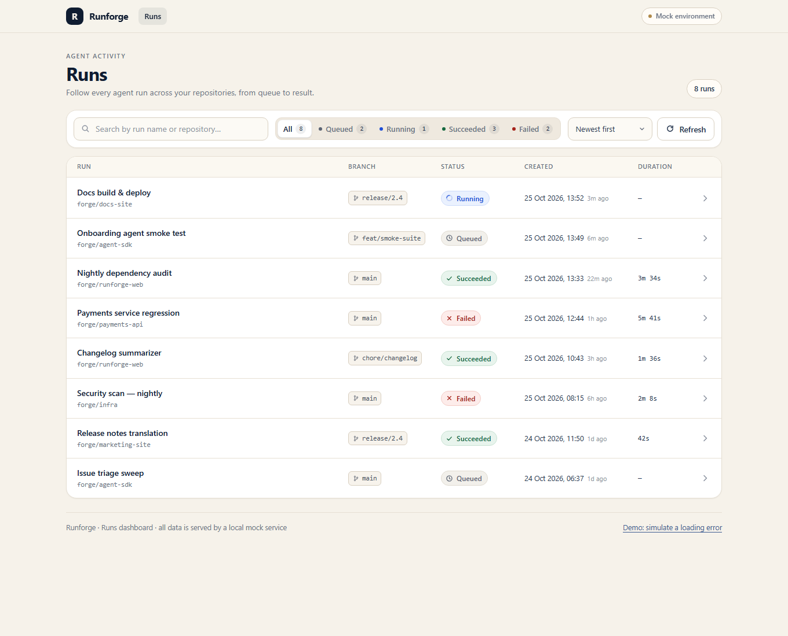
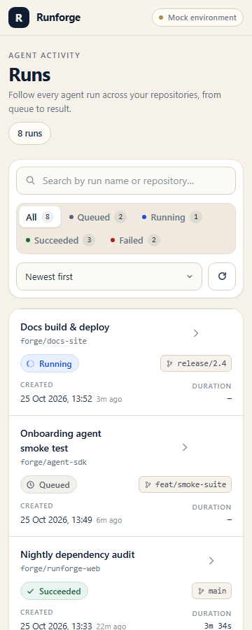

# Runforge — Runs

Страница **Runs** для Runforge: дашборд запусков AI-агентов. Список запусков с поиском, фильтром по статусу, сортировкой и панелью деталей (логи и результат). Данные отдаёт локальный mock-сервис — настоящего backend нет.



## Стек

- React 19 + TypeScript
- Vite 6
- Vitest + React Testing Library + user-event (jsdom)
- Чистый CSS с дизайн-токенами (без UI-библиотек)

## Установка и запуск

Нужен Node.js 20+ (проверено на Node 22.16) и любой из пакетных менеджеров. Проект собран на pnpm 11, есть `pnpm-lock.yaml`.

```bash
pnpm install
pnpm dev
```

Дев-сервер: <http://localhost:5173>.

Если используете npm:

```bash
npm install
npm run dev
```

В `pnpm-workspace.yaml` разрешён build-скрипт `esbuild` — этого требует pnpm 11, иначе `node_modules` останется неполным и Vite не запустится.

## Тесты

```bash
pnpm test
```

Четыре теста в `src/App.test.tsx`:

1. фильтрация по статусу;
2. поиск по name и repository (включая совместную работу с фильтром и сброс из empty state);
3. открытие деталей запуска (логи, result) и возврат к списку;
4. состояние ошибки и восстановление по кнопке «Retry».

Тесты работают с реальным mock-сервисом, поэтому ждут его задержку (520–800 мс) — отсюда таймауты в `findBy*`.

## Скрипты

| Команда | Что делает |
| --- | --- |
| `pnpm dev` | дев-сервер Vite |
| `pnpm build` | проверка типов (`tsc --noEmit`) + production-сборка в `dist/` |
| `pnpm preview` | предпросмотр собранного приложения |
| `pnpm test` | один прогон тестов |
| `pnpm test:watch` | тесты в watch-режиме |

## Структура

```text
src/
├── api/
│   └── mockRuns.ts          # mock-сервис: 8 запусков, задержка 520–800 мс, режим ошибки
├── components/
│   ├── AppHeader.tsx        # шапка продукта
│   ├── AppFooter.tsx        # подпись mock-окружения + демо ошибки
│   ├── RunsToolbar.tsx      # поиск, фильтр по статусу, сортировка, обновление
│   ├── RunList.tsx          # таблица-список + заголовок колонок
│   ├── RunRow.tsx           # строка запуска (на мобильных — карточка)
│   ├── RunStatusBadge.tsx   # бейдж статуса: иконка + текст
│   ├── RunDetailsDrawer.tsx # drawer с метаданными, result и логами
│   ├── RunsSkeleton.tsx     # skeleton на время загрузки
│   ├── EmptyState.tsx       # пустой результат + сброс фильтров
│   ├── ErrorState.tsx       # ошибка + «Retry»
│   └── icons.tsx            # инлайновые SVG-иконки
├── hooks/
│   ├── useRuns.ts           # загрузка, отмена запросов, loading/error/ready
│   └── useQueryState.ts     # состояние страницы в URL + popstate
├── lib/
│   ├── format.ts            # даты, относительное время, длительность
│   ├── runs.ts              # фильтрация, поиск, сортировка, счётчики
│   └── urlQuery.ts          # сериализация/парсинг query-параметров
├── test/setup.ts            # jest-dom, очистка DOM и URL между тестами
├── App.tsx                  # композиция страницы и обработчики
├── App.test.tsx
├── main.tsx
├── styles.css               # токены, компонентные стили, адаптив
└── types.ts                 # Run, RunStatus, StatusFilter, SortKey
```

## Поведение и решения

**Загрузка.** Skeleton повторяет сетку реальных строк, поэтому при появлении данных ничего не «прыгает». Задержка mock-сервиса видна, запрос можно отменить (AbortController) — при размонтировании или повторном запросе.

**Ошибка.** Кнопка «Retry» перезапрашивает данные. Состояние ошибки можно посмотреть вручную: ссылка «Demo: simulate a loading error» в футере или параметр `?fail=1`.

**Пустой результат.** Сообщение объясняет, что именно не совпало (поиск и/или статус), и предлагает кнопку «Reset search and filters».

**Статусы.** Подпись + иконка + цвет: «Queued» (часы), «Running» (вращающееся кольцо), «Succeeded» (галочка), «Failed» (крестик). Один цвет не является единственным носителем смысла.

**Детали.** Drawer открывается по клику на всю строку. Показывает статус, ID, репозиторий, ветку, дату, длительность, результат и логи (ошибки и предупреждения подсвечены). Закрывается кнопкой «Back to runs», крестиком, Esc, кликом по подложке и кнопкой «Назад» браузера. Фокус удерживается внутри drawer, при закрытии возвращается на строку списка.

**URL-состояние.** Фильтр, поиск, сортировка и открытый запуск живут в query-параметрах, поэтому ссылку можно скопировать, а «Назад»/«Вперёд» работают ожидаемо:

```text
/?status=failed&q=payments&sort=longest&run=run_1a9f53
```

| Параметр | Значения |
| --- | --- |
| `status` | `queued`, `running`, `succeeded`, `failed` (по умолчанию — все) |
| `q` | строка поиска по name и repository |
| `sort` | `newest` (по умолчанию), `oldest`, `longest`, `shortest` |
| `run` | ID запуска, открывает drawer |
| `fail` | `1` — принудительная ошибка загрузки для демонстрации |

**Сортировка.** По дате и по длительности. Запуски без `durationSeconds` всегда остаются в конце списка.

**Адаптив.** От 360px: строки превращаются в карточки с подписями полей, фильтры переносятся на новую строку, drawer занимает весь экран. Горизонтального скролла у страницы нет (проверено на 360px и 1360px).



**Данные.** 8 запусков, покрыты все четыре статуса. У части запусков нет `durationSeconds` и/или `result` — интерфейс показывает «—» и понятное сообщение вместо пустоты. Даты форматируются через `Intl.DateTimeFormat` в локальной зоне; невалидная дата не ломает рендер.

**Доступность.** Семантические кнопки и заголовки, `aria-pressed` у фильтров, `role="dialog"` + `aria-modal` у drawer, видимый focus-ring, skip-link, `prefers-reduced-motion`. Статусы подписаны текстом.

## Mock-сервис

`fetchRuns()` в `src/api/mockRuns.ts` возвращает `Promise<Run[]>` с искусственной задержкой 520–800 мс (при `?fail=1` — отклонённый промис). Реальные модели, GitHub, авторизация и sandbox не подключены.

## Что можно улучшить дальше

- пагинация и виртуализация при большом числе запусков;
- повторное использование компонента строки на других страницах;
- e2e-тесты (Playwright) для сценария с историей браузера.
